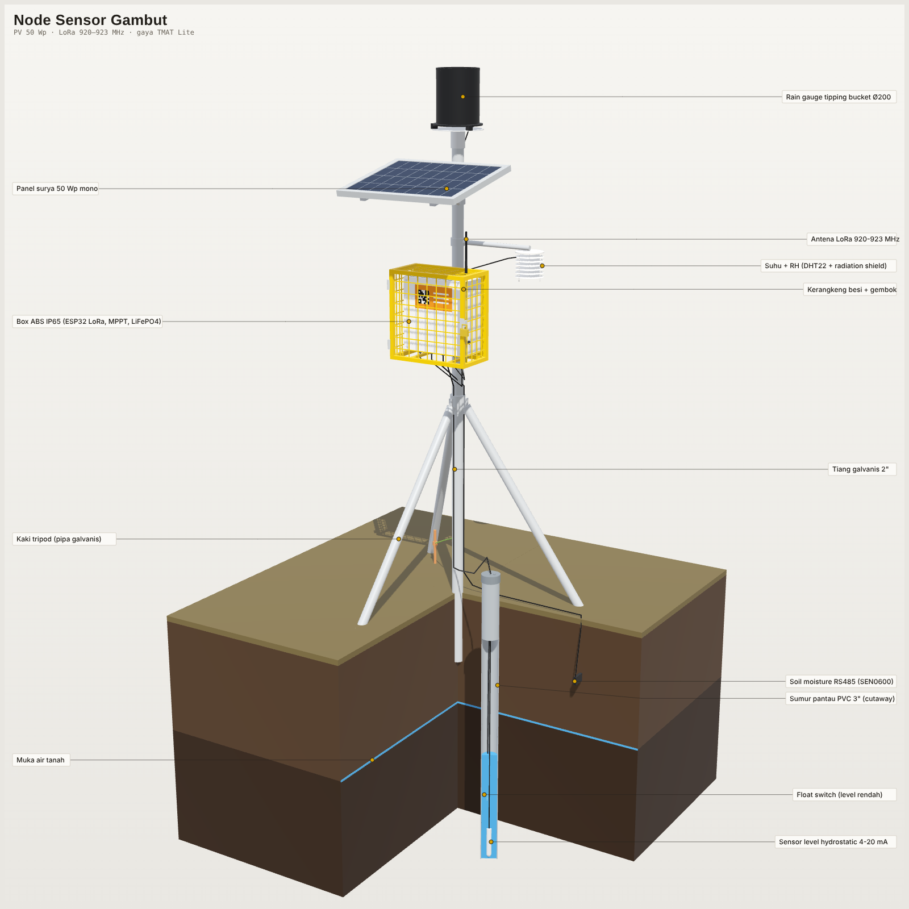

# SIGAP Gambut – Desain 3D Node Sensor

Model 3D parametrik untuk node sensor IoT pemantau lahan gambut. Node ini memakai panel surya 50 Wp dan mengirim data lewat LoRa 920–923 MHz. Bentuknya mengikuti alat ukur TMAT Lite: tiang galvanis 2" dengan tripod, panel surya di atas, dan kerangkeng besi kuning bergembok berisi box ABS IP65. Ada juga sumur pantau yang ditampilkan terpotong (cutaway).

**Viewer 3D interaktif:** https://yarigainoarushigoto.github.io/SIGAP-Gambut3DDesign/



## Komponen yang dimodelkan

| Kelompok | Isi |
|---|---|
| Struktur | Tiang galvanis Ø60,3 mm, tripod 3 kaki, klem, lengan DHT22 |
| Energi | Panel surya 50 Wp mono (670 × 540 mm, kemiringan 12°), bracket |
| Box & kerangkeng | Kerangkeng besi kuning + gembok, box ABS IP65 360 × 160 × 380 mm, cable gland, antena LoRa 915 MHz 3 dBi |
| Isi box | Baterai LiFePO4 12,8 V 20 Ah, MPPT 20 A, TTGO LoRa32 V2.1 (ESP32 + SX1276), buck 5 V, step-up 24 V, ADS1115, MAX485, fuse/MCB |
| Sensor | Rain gauge tipping bucket Ø200, DHT22 + radiation shield, sumur pantau PVC 3", sensor level hydrostatic 4-20 mA, float switch, soil moisture RS485 (SEN0600) |
| Lingkungan | Tanah gambut cutaway (zona tak jenuh dan jenuh), garis muka air tanah, grounding rod |

Total 53 part, masing-masing bernama dan berwarna.

## File model (`model/`)

| File | Dibuka dengan | Catatan |
|---|---|---|
| `node_sensor.glb` | Blender, Windows 3D Viewer, PowerPoint (Sisipkan > Model 3D), gltf-viewer online | Nama part, grup, dan warna tetap ada. Satuan meter, Y ke atas. |
| `node_sensor.obj` + `.mtl` | SketchUp, Fusion 360, Tinkercad, FreeCAD, 3ds Max | Simpan keduanya di folder yang sama. Satuan mm, Y ke atas. |
| `node_sensor.stl` | SolidWorks, slicer printer 3D | Satu mesh gabungan tanpa warna. Satuan mm, Z ke atas. |
| `node_sensor.scad` | OpenSCAD 2019.05+ | Solid CSG, satu module per part. Bisa dibuka di FreeCAD lalu diekspor ke STEP. |

GLB, OBJ, dan STL berupa mesh: bisa diedit bebas tetapi bukan solid parametrik. Untuk mengubah dimensi dengan rapi, ubah parameternya di generator.

## Mengubah desain

Semua dimensi (mm) ada di blok `PARAMETER` pada `src/model_node_sensor.py`. Contohnya:

- `pole_top`, `pole_d`, `leg_foot_r`: tinggi tiang, diameter pipa, lebar tripod
- `pv_l`, `pv_w`, `pv_tilt`: ukuran dan kemiringan panel surya
- `cage_w/d/h`, `box_w/d/h`: ukuran kerangkeng dan box
- `water_z`, `well_bottom`: contoh muka air tanah dan kedalaman sumur pantau
- `probe_z`: kedalaman sensor soil moisture

Setelah mengubah parameter, buat ulang file model dan viewer (hanya butuh Python 3 + numpy):

```bash
python3 src/model_node_sensor.py model   # menulis ulang model/*.glb, .obj, .stl, .scad
python3 src/build_viewer.py              # membuat ulang index.html
```

## Struktur repo

```
index.html              viewer 3D (WebGL, tanpa library luar), dipakai GitHub Pages
model/                  file 3D hasil ekspor
renders/                gambar render untuk proposal/slide
src/model_node_sensor.py  generator parametrik
src/viewer_template.html  template viewer
src/build_viewer.py       menyisipkan data model ke index.html
```
